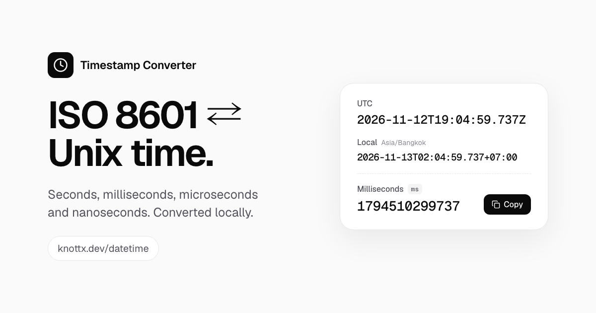

# Timestamp Converter

A minimalist, private converter between ISO 8601 dates and Unix timestamps that runs entirely in your browser.

**Live:** [https://knottx.dev/datetime/](https://knottx.dev/datetime/)



## Overview

Open the page and the current time is already shown in every format, ready to copy. Unix milliseconds, the value Remote Config usually needs, gets the primary copy button. To read an unfamiliar value, paste it into the Convert panel. Pasted values convert immediately.

Every output comes from one instant. Values stay the same until you press **Now** or convert something else.

## Outputs

| Output             | Example (Asia/Bangkok)                |
| ------------------ | ------------------------------------- |
| UTC ISO 8601       | `2026-11-12T19:04:59.737Z`            |
| Local ISO 8601     | `2026-11-13T02:04:59.737+07:00`       |
| Unix seconds (s)   | `1794510299`                          |
| Milliseconds (ms)  | `1794510299737`                       |
| Microseconds (µs)  | `1794510299737000`                    |
| Nanoseconds (ns)   | `1794510299737000000`                 |

The local row also shows the browser's IANA timezone ID and the UTC offset at the displayed instant. Copy buttons put the exact value on the clipboard, with no labels, digit grouping, or extra whitespace.

## Supported inputs

- **Unix timestamp:** a signed base-10 integer. Surrounding whitespace is trimmed. Decimals, exponent notation (`1e9`), and digit separators (`1,794,510,299`) are rejected. Choose the unit (s, ms, µs, ns) explicitly. It defaults to seconds and is never guessed from the digit count. If the digit count suggests a different unit, the app shows a hint with a one-click switch.
- **ISO 8601:** `YYYY-MM-DDTHH:mm:ss`, optionally followed by 1–9 fractional digits, then a required `Z` or `±HH:MM` offset. The date, time, and offset are validated first, so dates like `2026-02-30`, `24:00:00`, and leap seconds (`:60`) are rejected. A value without a timezone is rejected with a prompt to add one or to use Local date & time mode.
- **Local date & time:** a native date and time picker, read in the browser's timezone using that date's offset.
  - A time skipped by a daylight saving change is rejected, and the message suggests the matching time after the change.
  - A time that occurs twice resolves to the earlier occurrence, and the app shows its offset. One click converts the later occurrence, which is also available as an explicit-offset ISO 8601 string.

## Precision and rounding

- The instant is stored as an integer number of **epoch nanoseconds** (`BigInt`). Unix input is parsed directly into `BigInt`, and unit conversion uses integer arithmetic only.
- Converting to a coarser unit uses **floor** rounding (toward negative infinity). For example, `-1` ns shows as `-1` ms and formats as `1969-12-31T23:59:59.999999999Z`.
- ISO 8601 output has at least 3 fractional digits. Further significant digits are kept up to nanoseconds, so `1794510299737123456` ns round-trips exactly through `2026-11-12T19:04:59.737123456Z`.
- **Now** reads the browser clock (`Date.now()`) at millisecond precision. Its µs and ns values end in zeros.
- Local offsets are calculated for the displayed instant, not the current one. Historical local mean time offsets keep their seconds (e.g. `+06:42:04`).

### Supported range

`0001-01-02T00:00:00Z` to `9999-12-30T23:59:59.999999999Z`. That is −62135510400 to 253402214399 in seconds.

The range stops one day short of each end of years 0001–9999. That way, local time in every timezone also has a four-digit year. Values are checked against the range as `BigInt` before they're converted to a `Date`.

## Privacy

All conversions run locally in your browser. Inputs and results are never stored, logged, or sent over the network. The app has no backend and no analytics. The only thing saved is your theme preference (`datetime:theme` in `localStorage`). The app works normally if storage is unavailable.

## Tech stack

- [TypeScript](https://www.typescriptlang.org) (strict mode), no framework
- [Vite](https://vite.dev)
- [Tailwind CSS v4](https://tailwindcss.com)
- [Lucide](https://lucide.dev) icons
- [Geist and Geist Mono](https://vercel.com/font), self-hosted via Fontsource
- Native `BigInt`, `Date`, and `Intl.DateTimeFormat` (no date library)

Parsing and formatting live in [`src/lib/time.ts`](src/lib/time.ts), which has no DOM access. [`src/main.ts`](src/main.ts) wires it to the page.

## Local development

Requires Node.js 20.19+. Node 24 is recommended. `npm test` needs Node 23.6+ to run TypeScript directly.

```bash
npm install
npm run dev         # http://localhost:5173/datetime/
```

```bash
npm test            # conversion tests (sets TZ per case: Bangkok, New York, Lord Howe, …)
npm run typecheck   # TypeScript only
npm run build       # type-check + production build into dist/
npm run preview     # serve the production build at http://localhost:4173/datetime/
```

### VS Code

Press **F5** and pick a configuration:

- **Debug: Chrome (dev)** / **Debug: Edge (dev)** starts the dev server and opens the app with breakpoints in `src/`.
- **Debug: Chrome (production preview)** builds, then serves `dist/` under `/datetime/`.
- **Debug: conversion tests (Node)** runs `tests/time.test.ts` under the debugger.
- **Attach: Chrome (port 9222)** attaches to a Chrome you started with `--remote-debugging-port=9222`.

## Deployment (GitHub Pages)

This app is a GitHub Pages **project site** served at `https://knottx.dev/datetime/`, through the custom domain configured on the main user site. For that reason:

- `vite.config.ts` sets `base: '/datetime/'`, so every script, stylesheet, font, and icon URL starts with `/datetime/`.
- This repository has **no `CNAME` file**. The custom domain belongs to the user site repository.

[`.github/workflows/deploy.yml`](.github/workflows/deploy.yml) handles deployment. On every push to `main`, it runs `npm ci`, the tests, the type check, and the build. It then publishes `dist/` with the official `actions/upload-pages-artifact` and `actions/deploy-pages` actions. You can also run it manually from the **Actions** tab.

### One-time repository setup

1. Push this repository to GitHub as `datetime`. The repository name must match the `/datetime/` base path.
2. Open **Settings → Pages**. Under **Build and deployment**, set **Source** to **GitHub Actions**.
3. Check that the user site repository (`<username>.github.io`) has its custom domain set to `knottx.dev`. Project sites then become available at `https://knottx.dev/<repo>/` automatically.
